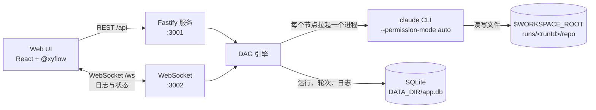
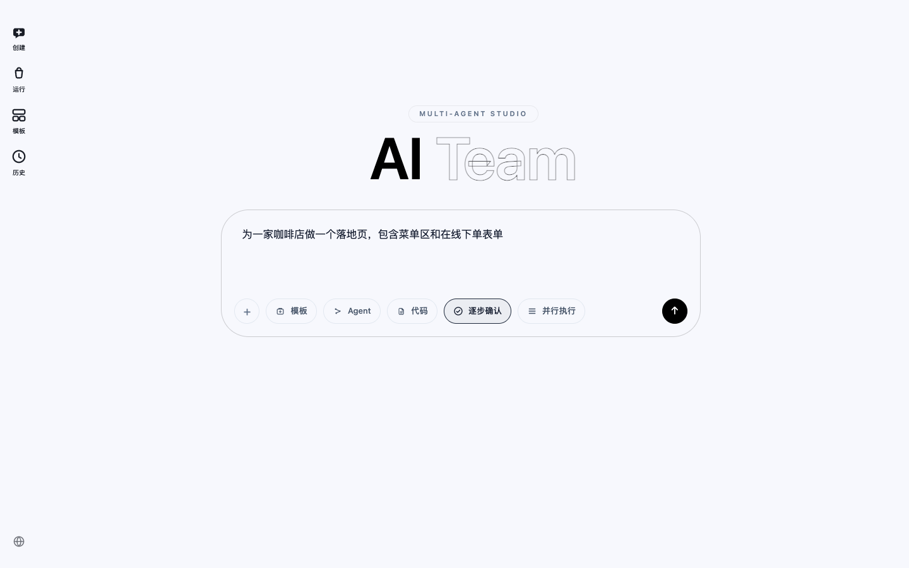
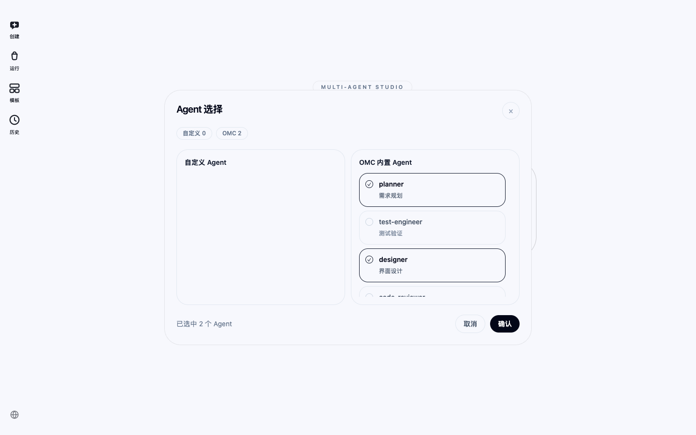
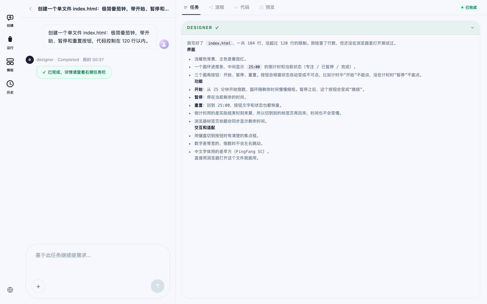
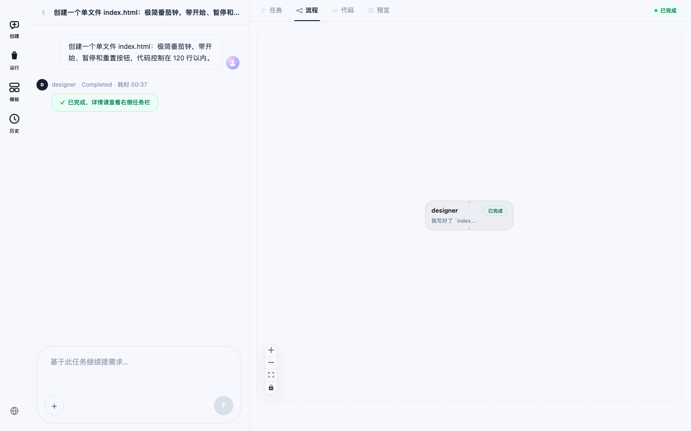
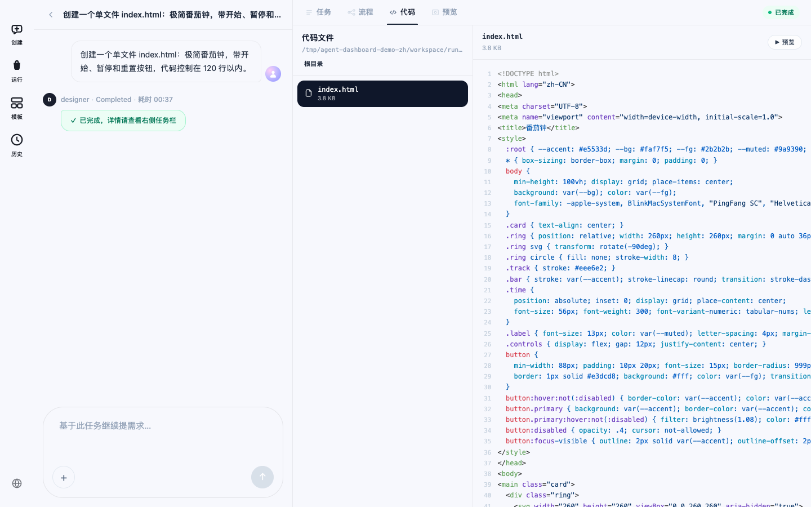
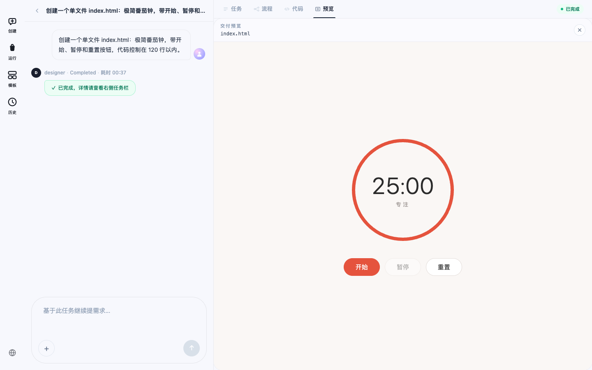
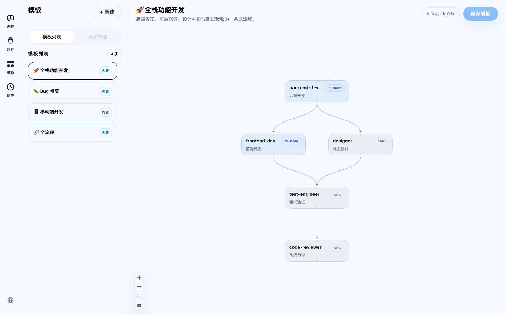
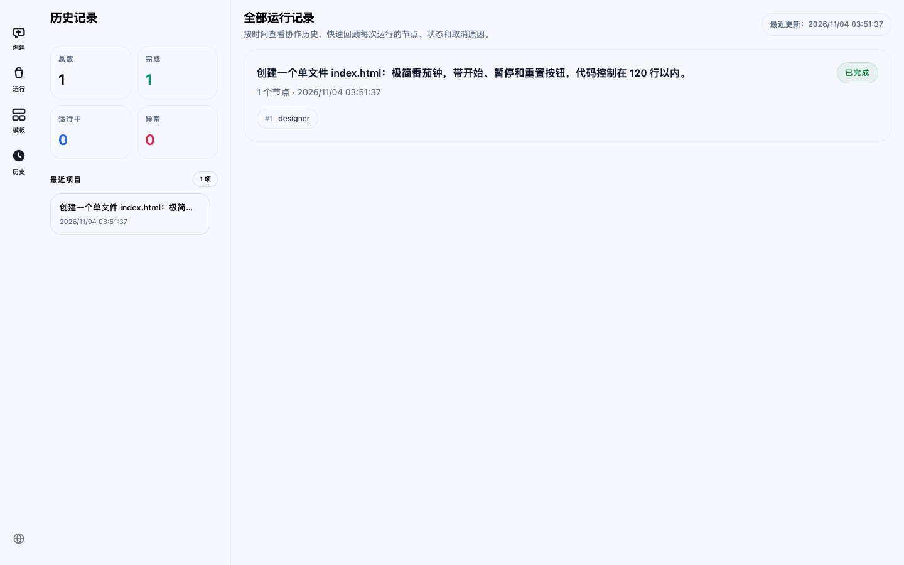

# Agent Dashboard

[English](README.md) | 中文

[](LICENSE)
[](https://github.com/AI-Pocket-Verse/agent-dashboard/actions/workflows/docker-publish.yml)


把多个 Claude Code agent 编排成 DAG 工作流的 Web 看板。描述任务，自己挑选 agent（或交给 AI 挑选），每个节点都会真实拉起一个 `claude` CLI 进程，节点状态和输出通过 WebSocket 推送到浏览器。运行结束后可以浏览 agent 写出的文件、预览生成的 HTML，并在同一个任务里继续下一轮。


▶ [观看完整演示视频（MP4）](docs/media/demo-zh.mp4) -- 真实运行全程录制，等待 agent 的部分做了加速。

## 目录

- [功能](#功能)
- [工作原理](#工作原理)
- [快速开始](#快速开始)
- [使用指南](#使用指南)
- [Agent 来源](#agent-来源)
- [Docker 部署](#docker-部署)
- [配置项](#配置项)
- [安全说明](#安全说明)
- [常见问题](#常见问题)
- [目录结构](#目录结构)
- [开发](#开发)
- [License](#license)

## 功能

- **DAG 工作流** -- 在画布上把自定义 agent 与 OMC 角色 agent 组合成流水线（基于 [@xyflow](https://reactflow.dev)）；节点输出通过 `{{nodes.<id>.output}}` 传入下游提示词。节点按依赖顺序执行，可以逐个运行，也可以让互不依赖的分支并行。
- **真实进程执行** -- 每个节点在独立的 run 工作区里运行 `claude` CLI；节点状态和每一行输出都通过 WebSocket 推送。
- **AI 智能选型** -- 描述任务，由 `claude` 自动挑选并连接合适的 agent。
- **人工确认** -- 开启「逐步确认」时，每个节点结束后运行会暂停，你可以查看结果、给下游节点补充要求，或终止运行。
- **自动修复循环** -- `code-reviewer` 节点发现阻塞性问题时，看板提供最多 3 轮自动修复，并路由给合适的 agent。
- **多轮任务** -- 运行结束后可以基于同一任务继续提需求，每一轮保留各自的 DAG 和日志。
- **工作区浏览与 HTML 预览** -- 查看每次运行产出的文件，在沙箱 iframe 里预览生成的 HTML 原型。
- **运行历史** -- 每次运行都保存在 SQLite，随时重新打开并分页查看日志。
- **中英双语界面** -- 默认跟随系统语言（简体中文 / 英文），侧边栏底部的语言开关可实时切换。
- **可选密码鉴权** -- `DASHBOARD_SECRET` 留空即本机免密模式；设置后一个密码同时保护 HTTP API 与 WebSocket 通道。

## 工作原理



1. 前端发送 `workflow:run` 消息，带上节点、连线和你的需求。
2. DAG 引擎启动上游已完成的节点：默认逐个运行，开启「并行执行」后同时启动所有可运行的节点。每个节点是一个 `claude -p` 进程，工作目录是本次运行的工作区 `$WORKSPACE_ROOT/runs/<runId>/repo`。
3. 进程的每一行 stdout/stderr 都通过 WebSocket 广播并写入 SQLite。`claude -p` 在节点结束时才输出结果，所以运行中的节点会一直显示「Running…」。
4. 节点结束后，它的输出可以通过 `{{nodes.<id>.output}}` 注入下游节点的提示词。

> agent 以 `--permission-mode auto` 运行，可以不经询问在工作区内修改文件、执行命令。只把看板指向你愿意让 agent 操作的目录。

## 快速开始

### 环境要求

- **Node.js 22 或更高版本**
- **pnpm 10** -- 仓库通过 `packageManager` 锁定版本，执行一次 `corepack enable` 后会自动使用正确版本
- 已安装并登录的 [Claude Code](https://claude.com/claude-code) CLI（`claude` 在 `PATH` 中）

### 本机运行

```bash
git clone https://github.com/AI-Pocket-Verse/agent-dashboard.git
cd agent-dashboard
./start.sh
```

首次运行时 `start.sh` 会：

1. 生成 `.env`：`DASHBOARD_SECRET` 留空（不鉴权），`PROJECT_ROOT` 设为仓库的**上级目录**，`WORKSPACE_ROOT` 设为 `<上级目录>/workspace`。想放到别处可以直接改 `.env`。
2. 没有 `node_modules` 时执行 `pnpm install`。
3. 启动服务端（HTTP 3001、WebSocket 3002）和 Web UI（5173）。日志写到 `/tmp/agent-dashboard-*.log`，同时输出到终端。
4. 打开 `http://localhost:5173`（macOS）。

`Ctrl+C` 停止；`./restart.sh` 会先释放 3001/3002/5173 端口再重新启动。

想手动控制：

```bash
pnpm install
PROJECT_ROOT=/path/to/your/projects pnpm dev   # 同时启动 server（tsx watch）和 client（vite）
```

## 使用指南

### 1. 描述任务

打开「创建」，写下你想做的东西。



输入框提供这些操作：

| 操作 | 作用 |
|---|---|
| **+** / **代码** | 选择文件或目录（`PROJECT_ROOT` 或个人主目录下）作为 agent 的代码上下文 |
| **Agent** | 自己挑选 agent，按选择顺序串成一条链执行 |
| **模板** | 直接运行已保存的工作流模板 |
| 粘贴 / 选择文件 | 添加图片或文件附件；输入 `@` 可以在需求里引用附件 |
| （什么都不选） | **AI 自动选择**：由 `claude` 挑选 agent 并连好 DAG |
| **逐步确认** | 默认开启：每个节点结束后暂停，等你确认再继续。关闭后一路跑完 |
| **并行执行** | 默认关闭。开启后，互不依赖的节点同时运行 |



### 2. 查看运行

提交后进入「运行」页。左侧是这个任务的对话区，显示每个节点的状态和耗时；右侧显示每个 agent 的输出。



开启「逐步确认」时，每个节点结束后运行会暂停并请你确认。你可以给后续 agent 补充要求、点确认继续，或终止运行。如果 `code-reviewer` 节点发现阻塞性问题，会改为弹出自动修复提示。

「流程」页展示当前轮次的 DAG 和各节点的实时状态：



### 3. 查看产出

「代码」页浏览本次运行的工作区并打开任意文本文件；「预览」页在沙箱 iframe 里渲染生成的 HTML 页面。





想继续推进，就在对话框里输入新需求。`claude` 会为同一个工作区规划新一轮 agent，在已有成果上接着做。

### 4. 编排工作流模板

「模板」是可复用工作流的画布。从内置模板或空白模板开始，添加 agent 节点、连线，并编辑每个节点的提示词。提示词里可以用两个占位符：

- `{{globalPrompt}}` -- 启动运行时输入的需求（新一轮里是追加的需求）
- `{{nodes.<id>.output}}` -- 上游节点的输出



### 5. 查看历史

「历史」列出每次运行的状态、参与的 agent 和开始时间。打开任意一条可以重新查看日志、文件和预览，也可以继续新一轮。



## Agent 来源

agent 列表由两部分组成：

- **自定义 agent** -- `$PROJECT_ROOT/.claude/agents/`（优先）和 `~/.claude/agents/` 下的 Claude Code subagent 文件（`*.md`）。自定义节点执行 `claude --agent <name>`。
- **OMC 角色 agent** -- `planner`、`architect`、`designer`、`test-engineer`、`code-reviewer`、`security-reviewer`、`writer`、`debugger`。这些不需要额外文件：节点执行普通的 `claude`，并在提示词里加上角色说明。如果装了 [oh-my-claudecode](https://github.com/Yeachan-Heo/oh-my-claudecode)，它的角色约束也会生效。

内置模板用到了自定义 agent `backend-dev`、`frontend-dev` 和 `flutter-dev`。请创建同名的 agent 文件，或把模板改成你已有的 agent。

## Docker 部署

`DASHBOARD_SECRET` 和 `PROJECT_ROOT` **必须**设置，缺少时 `docker compose` 会拒绝启动。（不设密码时服务端处于免密模式，只接受容器内部的请求，经 nginx 访问的 Web UI 会得到 `403`。）请把它们写进与 `docker-compose.yml` 同目录的 `.env` 文件，compose 的每个命令（包括 `down`、`logs`）都会读取：

```bash
cp .env.example .env   # 然后填写 DASHBOARD_SECRET（openssl rand -hex 16）、PROJECT_ROOT、ANTHROPIC_API_KEY、PUID/PGID
docker compose up -d
```

默认从 [GHCR](https://github.com/orgs/AI-Pocket-Verse/packages?repo_name=agent-dashboard) 拉取现成镜像（`ghcr.io/ai-pocket-verse/agent-dashboard-server` / `-client`）。想从源码构建，加上 `--build`。

然后访问 `http://<host>/`，在登录页输入 `DASHBOARD_SECRET`。

- 只有 nginx（80 端口，`client` 容器）对外暴露；它提供 Web UI，并在内部网络把 `/api` 代理到 server:3001、`/ws` 代理到 server:3002。
- server 容器内置 `claude` CLI，通过 `ANTHROPIC_API_KEY` 认证，所有 agent 节点和 AI 选型都用它。
- 运行历史持久化在宿主机的 `./server/data`；agent 工作区位于 `PROJECT_ROOT/workspace`。
- server 以非 root 用户 `PUID`:`PGID`（默认 `1000:1000`）运行，agent 在 `PROJECT_ROOT` 里创建的文件归你所有。Linux 上请设成自己的 `id -u` / `id -g`，并确保该用户对 `PROJECT_ROOT` 有写权限；macOS 的 Docker Desktop 会自动映射属主。容器启动时会把 `./server/data`（包括旧版以 root 运行时写入的数据）交给该用户。
- 凡是公网可访问的部署，请在前面加 TLS（token 在请求头里传输，包括 WebSocket 握手）。

**生产构建绝不要设置 `VITE_DASHBOARD_SECRET`** -- 它会把密码打进 JS 包。它只用于本地开发。

## 配置项

| 环境变量 | 默认值 | 用途 |
|---|---|---|
| `DASHBOARD_SECRET` | （空） | API 与 WebSocket 共用的密码；留空即关闭鉴权（本机模式）。部署时必填 |
| `PROJECT_ROOT` | 无（必填） | 代码上下文选择器的根目录，也是项目级 agent 的查找位置 |
| `WORKSPACE_ROOT` | `$PROJECT_ROOT/workspace` | 每次运行的 agent 工作区所在目录 |
| `CLAUDE_BIN` | `claude` | Claude CLI 可执行文件 |
| `PORT` | `3001` | HTTP 端口（WebSocket 使用 `PORT+1`） |
| `DATA_DIR` | `server/data` | SQLite 数据库（`app.db`），保存运行历史和模板 |
| `MAX_RUN_MINUTES` | `30` | 单个 agent 节点的最长运行时间，超时会被终止并在日志里写明原因；`0` 表示不限 |
| `AI_SELECT_TIMEOUT_MS` | `180000` | AI 自动选择和续轮规划的时间上限。自建反向代理时，读超时需大于该值（自带 nginx 为 200s） |
| `ANTHROPIC_API_KEY` | 无 | 仅在 `claude` 未登录的环境需要（例如 Docker 镜像） |

## 安全说明

- **免密模式（不设 `DASHBOARD_SECRET`）只服务本机。** 请求必须来自回环地址，`Host` 必须是 `localhost` / `127.0.0.1`，浏览器请求还必须来自本机页面；否则返回 `403`（WebSocket 以 `4403` 关闭）。这样可以挡住局域网里的其他设备和网页发起的跨站请求。想从其他设备或通过反向代理访问，请设置 `DASHBOARD_SECRET`。
- 设置密码后，HTTP API 要求 `Authorization: Bearer <secret>`（时间安全比对），WebSocket 握手通过 `Sec-WebSocket-Protocol` 请求头携带（`agent-dashboard, auth.<base64url(secret)>`），密码不会出现在 URL 和代理访问日志里。Web UI 只需输入一次，之后保存在 `localStorage`。
- 文件浏览只允许 `PROJECT_ROOT`、`WORKSPACE_ROOT` 和个人主目录，并拒绝 `.ssh`、`.env` 等隐藏路径。

## 常见问题

| 现象 | 处理 |
|---|---|
| `pnpm install` / `pnpm dev` 报 `ERR_PNPM_IGNORED_BUILDS` | 你用的是 pnpm 11 或更新版本，它会忽略本仓库的构建设置。执行 `corepack enable` 使用锁定的 pnpm 10，或用 `npx pnpm@10 install` 安装。 |
| 返回 `403 Forbidden`，或 WebSocket 以 `4403` 关闭 | 免密模式只接受本机请求。想从其他设备或通过反向代理访问，请设置 `DASHBOARD_SECRET`。 |
| AI 自动选择（或继续任务）报 `AI selection timed out` | 规划步骤执行 `claude -p`，上限 3 分钟。如果你的 `claude` 启动较慢（插件、hooks、MCP server 较多），可调大 `AI_SELECT_TIMEOUT_MS`，或手动选择 agent、使用模板。 |
| 节点失败并显示「[系统] 运行时间超过上限」 | 节点达到了 `MAX_RUN_MINUTES`（默认 30 分钟）。调大该值，或设为 `0` 表示不限。 |
| 自定义 agent 节点报 `--agent '<name>' not found` | 缺少 agent 文件。请在 `PROJECT_ROOT` 或个人主目录下添加 `.claude/agents/<name>.md`。 |
| 3001 / 3002 / 5173 端口报 `EADDRINUSE` | 执行 `./restart.sh`，它会先释放这些端口。 |
| `docker compose up` 拉不到镜像 | 镜像在推送 `v*` tag 时发布。可以用 `docker compose up -d --build` 本地构建。 |

## 目录结构

```text
agent-dashboard/
├── client/               # React 19 + Vite Web UI
│   └── src/
│       ├── pages/        # 创建（Dashboard）、运行（RunnerPage）、模板（Canvas）、历史（History）
│       ├── components/   # 任务输入、日志流、文件查看、弹窗等
│       ├── store/        # zustand 状态
│       └── lib/          # API 客户端、鉴权、i18n
├── server/               # Fastify API + WebSocket 服务
│   └── src/
│       ├── workflows/    # DAG 引擎、内置模板、文件监听
│       ├── processes/    # claude CLI 进程管理
│       ├── routes/       # REST 接口（runs、templates、agents、fs、ai）
│       ├── store/        # SQLite 持久化
│       └── ws/           # WebSocket 服务与消息处理
├── shared/types.ts       # client 与 server 共用的类型
├── docker-compose.yml    # nginx（client）+ server
└── start.sh / restart.sh # 本地启动脚本
```

## 开发

```bash
pnpm install
pnpm --filter server test && pnpm --filter client test
pnpm --filter client build
pnpm dev   # server + client 热更新
```

## License

[Apache-2.0](LICENSE)
