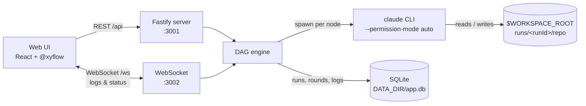
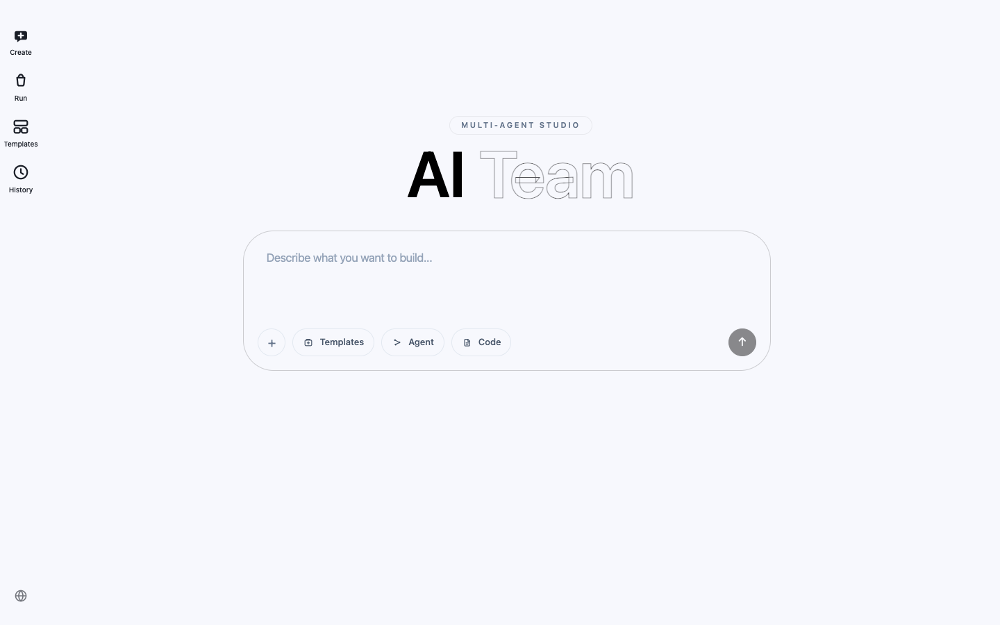
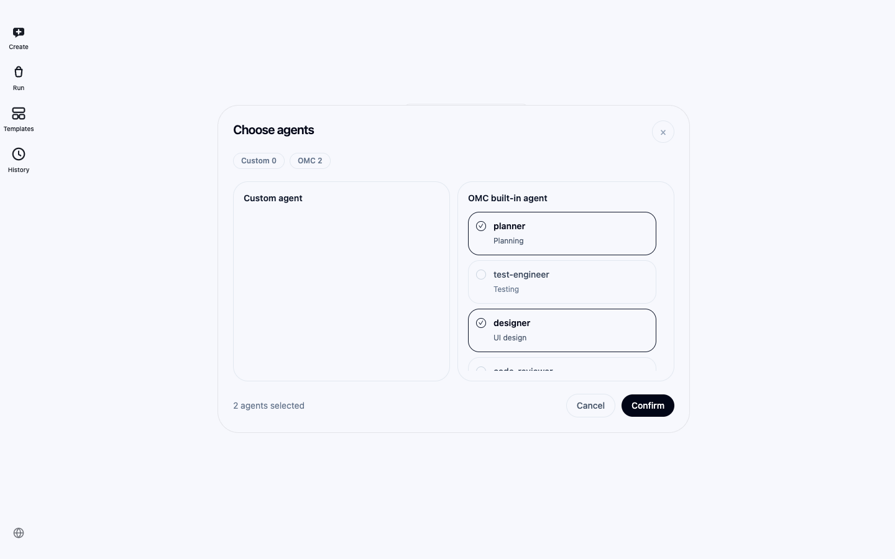
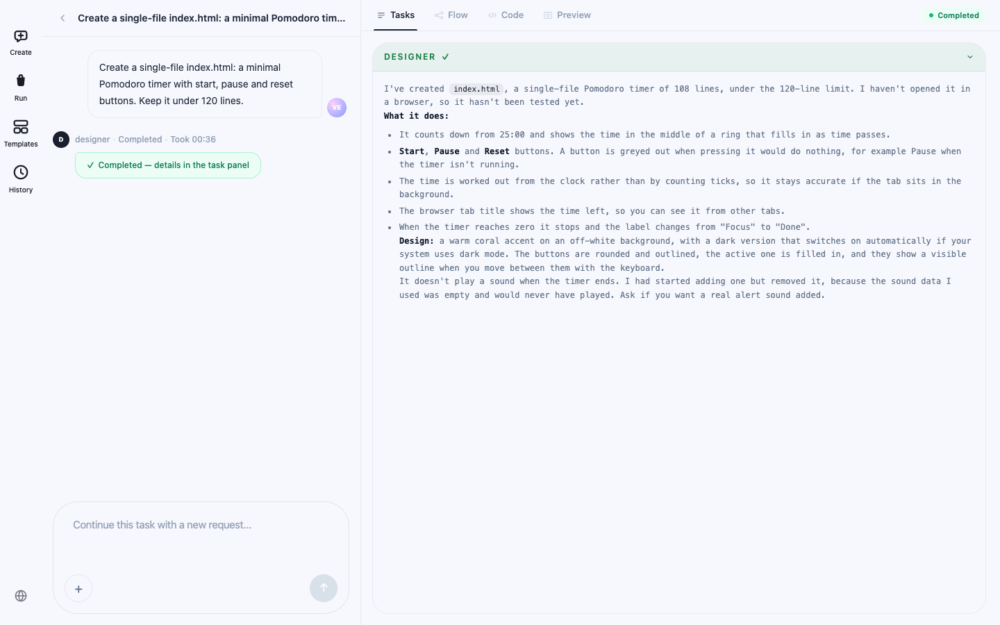
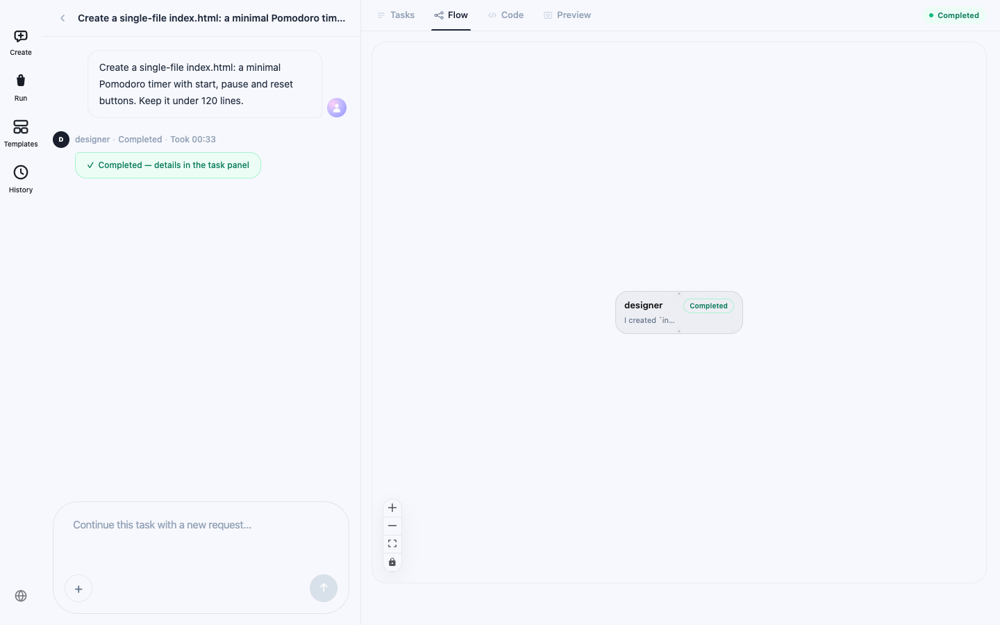
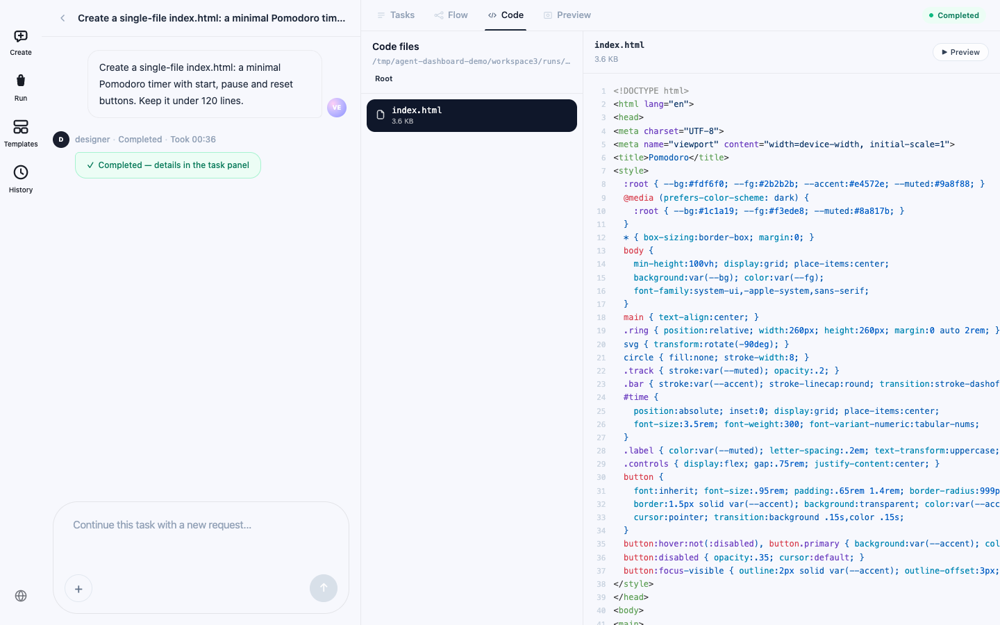
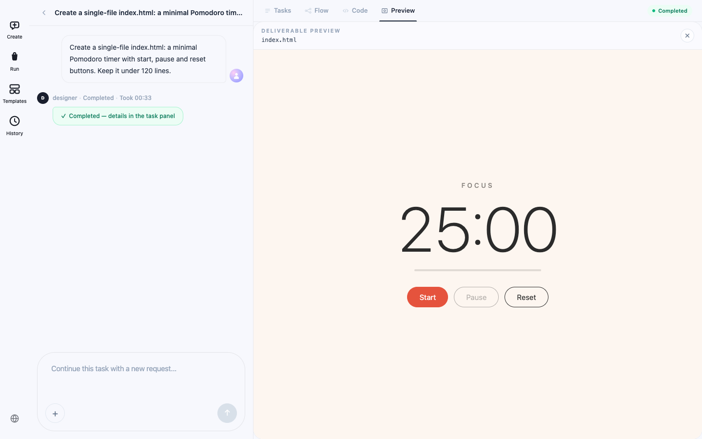
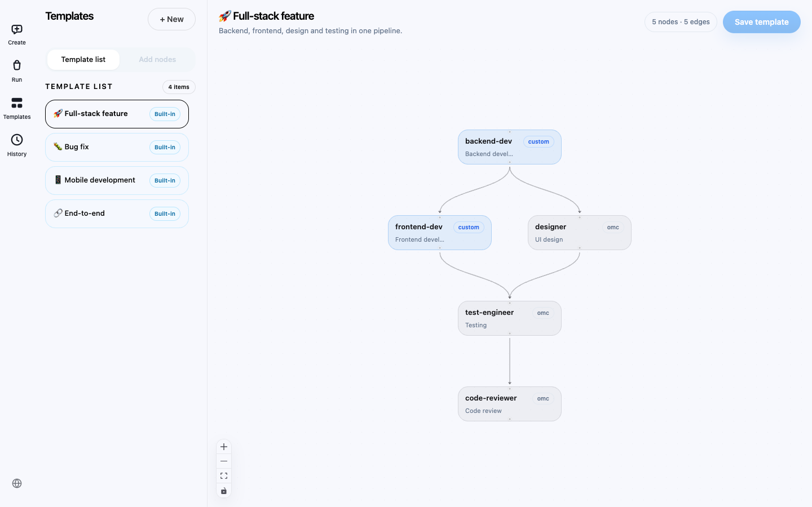
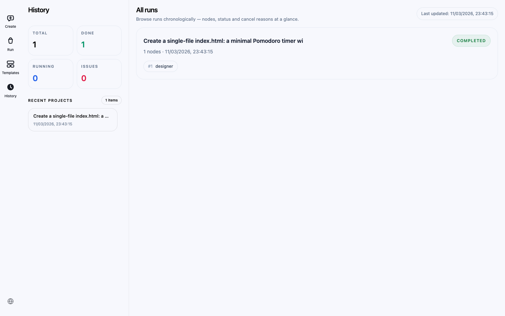

# Agent Dashboard

English | [中文](README-CN.md)

[](LICENSE)
[](https://github.com/AI-Pocket-Verse/agent-dashboard/actions/workflows/docker-publish.yml)


A web dashboard for orchestrating multiple Claude Code agents as DAG workflows. Describe a task, pick agents (or let AI pick them), and watch each node run as a real `claude` CLI process, with status and output pushed to the browser over WebSocket. Then browse the files the agents wrote, preview generated HTML, and continue the same task in a new round.


▶ [Watch the full demo video (MP4)](docs/media/demo.mp4) — a real run, recorded end to end; the waiting part is sped up.

## Contents

- [Features](#features)
- [How it works](#how-it-works)
- [Quick start](#quick-start)
- [Usage guide](#usage-guide)
- [Agents](#agents)
- [Deploy with Docker](#deploy-with-docker)
- [Configuration](#configuration)
- [Security](#security)
- [Troubleshooting](#troubleshooting)
- [Project structure](#project-structure)
- [Development](#development)
- [License](#license)

## Features

- **DAG workflows** — compose custom agents and OMC role agents into pipelines on a canvas (powered by [@xyflow](https://reactflow.dev)); a node's output flows into downstream prompts via `{{nodes.<id>.output}}`. Nodes run in dependency order — one at a time, or independent branches in parallel.
- **Real process execution** — each node runs the `claude` CLI in a per-run workspace; node status and every output line are pushed over WebSocket.
- **AI agent selection** — describe a task and let `claude` pick and wire the right agents for you.
- **Human in the loop** — with **Confirm steps** on, the run pauses after each node so you can review the result, add instructions for downstream nodes, or stop the run.
- **Auto-fix loop** — when a `code-reviewer` node reports blocking issues, the dashboard offers up to 3 automatic fix rounds routed to the right agent.
- **Multi-round tasks** — continue a finished run with a follow-up request; every round keeps its own DAG and logs.
- **Workspace browser & HTML preview** — inspect every file a run produced, and preview generated HTML prototypes in a sandboxed iframe.
- **Run history** — every run is saved to SQLite; reopen it at any time and page through its logs.
- **Bilingual UI** — follows your system language (Simplified Chinese / English), with a switcher at the bottom of the sidebar.
- **Optional password auth** — leave `DASHBOARD_SECRET` empty for zero-friction local use; set it and one password protects both the HTTP API and the WebSocket channel.

## How it works



1. The UI sends a `workflow:run` message with nodes, edges and your request.
2. The DAG engine starts nodes whose upstream nodes are done — one at a time by default, or all of them at once with **Parallel** on. Each node is a `claude -p` process whose working directory is the run workspace `$WORKSPACE_ROOT/runs/<runId>/repo`.
3. Every stdout/stderr line is broadcast over WebSocket and persisted to SQLite. `claude -p` prints its answer when the node finishes, so a node shows *Running…* until then.
4. When a node finishes, its output transcript can be injected into downstream prompts with `{{nodes.<id>.output}}`.

> Agents run with `--permission-mode auto`, so they can edit files and run commands inside the run workspace without asking. Only point the dashboard at directories you are happy for agents to work in.

## Quick start

### Requirements

- **Node.js 22 or newer**
- **pnpm 10** — the repo pins it through `packageManager`; run `corepack enable` once and the right version is used automatically
- [Claude Code](https://claude.com/claude-code) CLI installed and signed in (`claude` on `PATH`)

### Run locally

```bash
git clone https://github.com/AI-Pocket-Verse/agent-dashboard.git
cd agent-dashboard
./start.sh
```

On first run `start.sh`:

1. Generates `.env` — empty `DASHBOARD_SECRET` (auth disabled), `PROJECT_ROOT` set to the **parent directory** of the repo, `WORKSPACE_ROOT` set to `<parent>/workspace`. Edit `.env` if you want them elsewhere.
2. Installs dependencies (`pnpm install`) if `node_modules` is missing.
3. Starts the server (HTTP 3001, WebSocket 3002) and the web UI (5173). Logs go to `/tmp/agent-dashboard-*.log` and are also streamed to the terminal.
4. Opens `http://localhost:5173` (macOS).

Stop with `Ctrl+C`. `./restart.sh` frees ports 3001/3002/5173 and starts again.

Prefer manual control?

```bash
pnpm install
PROJECT_ROOT=/path/to/your/projects pnpm dev   # server (tsx watch) + client (vite)
```

## Usage guide

### 1. Describe the task

Open **Create** and describe what you want to build.



The input bar offers:

| Control | What it does |
|---|---|
| **+** / **Code** | Attach files or directories (under `PROJECT_ROOT` or your home directory) as code context for the agents |
| **Agent** | Pick agents yourself; they run as a chain in the order you select them |
| **Templates** | Run a saved workflow template instead |
| Paste / file picker | Attach images or files; type `@` to reference an attachment in the prompt |
| *(nothing picked)* | **AI auto-select** — `claude` chooses the agents and wires the DAG for you |
| **Confirm steps** | On by default: pause after each node until you confirm. Turn it off to run straight through |
| **Parallel** | Off by default. Turn it on to run nodes that do not depend on each other at the same time |



### 2. Watch the run

Submitting takes you to **Run**. The left pane is the conversation for this task, with each node's status and elapsed time; the right pane shows each agent's output once it arrives.



With **Confirm steps** on, the run pauses after each node and asks for confirmation. You can add instructions for the next agents, confirm, or stop the run. If a `code-reviewer` node finds blocking issues, an auto-fix offer appears instead.

The **Flow** tab shows the DAG of the current round with live node status:



### 3. Inspect the results

**Code** browses the run workspace and opens any text file; **Preview** renders the generated HTML page in a sandboxed iframe.





To keep going, type a follow-up request in the chat box. `claude` plans a new round of agents for the same workspace, so they build on what is already there.

### 4. Build workflow templates

**Templates** is a canvas for reusable workflows. Start from a built-in template or a blank one, add agent nodes, connect them, and edit each node's prompt. Two placeholders are available in prompts:

- `{{globalPrompt}}` — the request you typed when starting the run (or the follow-up request in a new round)
- `{{nodes.<id>.output}}` — the output of an upstream node



### 5. Review history

**History** lists every run with its status, agents and start time. Open one to see its logs, files and preview again, or continue it with a new round.



## Agents

The agent list combines two sources:

- **Custom agents** — Claude Code subagent files (`*.md`) found in `$PROJECT_ROOT/.claude/agents/` (takes priority) and `~/.claude/agents/`. A custom node runs `claude --agent <name>`.
- **OMC role agents** — `planner`, `architect`, `designer`, `test-engineer`, `code-reviewer`, `security-reviewer`, `writer`, `debugger`. These need no files: the node runs plain `claude` with the role added to the prompt. If you use [oh-my-claudecode](https://github.com/Yeachan-Heo/oh-my-claudecode), its role guidance applies too.

The built-in templates reference the custom agents `backend-dev`, `frontend-dev` and `flutter-dev`. Create agent files with those names, or edit the template to use agents you have.

## Deploy with Docker

For servers, `DASHBOARD_SECRET` is **required**. Without it the server runs in open mode, which only accepts requests from inside its own container, so the web UI behind nginx gets `403`.

```bash
DASHBOARD_SECRET=$(openssl rand -hex 16) \
PROJECT_ROOT=/path/to/your/projects \
ANTHROPIC_API_KEY=sk-ant-... \
docker compose up -d
```

This pulls prebuilt images from [GHCR](https://github.com/orgs/AI-Pocket-Verse/packages?repo_name=agent-dashboard) (`ghcr.io/ai-pocket-verse/agent-dashboard-server` / `-client`). To build from source instead, add `--build`.

Then open `http://<host>/` and enter your `DASHBOARD_SECRET` in the login gate.

- Only nginx (port 80, the `client` container) is exposed; it serves the web UI and proxies `/api` → server:3001 and `/ws` → server:3002 on the internal network.
- The server container ships the `claude` CLI, which authenticates with `ANTHROPIC_API_KEY` — every agent node and the AI selection use it.
- Run history persists in `./server/data` on the host; agent workspaces live under `PROJECT_ROOT/workspace`.
- For anything reachable from the internet, put TLS in front (the token travels in headers and the WebSocket query string).

**Never set `VITE_DASHBOARD_SECRET` for a production build** — it would bake the secret into the JS bundle. It exists only as a local-dev convenience.

## Configuration

| Env var | Default | Purpose |
|---|---|---|
| `DASHBOARD_SECRET` | (empty) | Shared password for API + WebSocket; empty disables auth (local mode). Required for deployments |
| `PROJECT_ROOT` | — (required) | Root directory for the code-context picker and project-level agents |
| `WORKSPACE_ROOT` | `$PROJECT_ROOT/workspace` | Where per-run agent workspaces are created |
| `CLAUDE_BIN` | `claude` | Claude CLI binary |
| `PORT` | `3001` | HTTP port (WebSocket uses `PORT+1`) |
| `DATA_DIR` | `server/data` | SQLite database (`app.db`) with run history and templates |
| `MAX_RUN_MINUTES` | `30` | Longest a single agent node may run before it is stopped (the reason is written to its log); `0` = no limit |
| `AI_SELECT_TIMEOUT_MS` | `180000` | Time limit for AI agent selection and for planning a follow-up round. Behind your own reverse proxy, keep its read timeout above this (the bundled nginx uses 200s) |
| `ANTHROPIC_API_KEY` | — | Only needed where `claude` is not signed in (e.g. the Docker image) |

## Security

- **Open mode (no `DASHBOARD_SECRET`) only serves this machine.** Requests must come from a loopback address with a `localhost` / `127.0.0.1` host, and browser requests must come from a local page; anything else gets `403` (WebSocket close code `4403`). This blocks other devices on your network and cross-site requests from web pages. To use the dashboard from another device, or behind Docker/nginx, set `DASHBOARD_SECRET`.
- With a secret set, the HTTP API requires `Authorization: Bearer <secret>` (timing-safe comparison) and the WebSocket requires `?secret=<secret>`. The web UI asks for it once and keeps it in `localStorage`.
- The file browser only lists `PROJECT_ROOT`, `WORKSPACE_ROOT` and your home directory, and refuses hidden paths such as `.ssh` or `.env`.

## Troubleshooting

| Symptom | Fix |
|---|---|
| `ERR_PNPM_IGNORED_BUILDS` during `pnpm install` / `pnpm dev` | You are running pnpm 11 or newer, which ignores this repo's build settings. Run `corepack enable` so the pinned pnpm 10 is used, or install with `npx pnpm@10 install`. |
| `403 Forbidden`, or the WebSocket closes with `4403` | Open mode only accepts requests from this machine. Set `DASHBOARD_SECRET` to use the dashboard from another device or behind a reverse proxy. |
| AI auto-select (or continuing a task) fails with `AI selection timed out` | Planning runs `claude -p` with a 3-minute limit. If your `claude` starts slowly (many plugins, hooks or MCP servers), raise `AI_SELECT_TIMEOUT_MS`, or pick agents manually / use a template. |
| A node fails with `[系统] 运行时间超过上限` | The node hit `MAX_RUN_MINUTES` (30 by default). Raise it, or set `0` for no limit. |
| A custom agent node fails with `--agent '<name>' not found` | The agent file is missing. Add `.claude/agents/<name>.md` under `PROJECT_ROOT` or your home directory. |
| `EADDRINUSE` on 3001 / 3002 / 5173 | Run `./restart.sh`, which frees those ports first. |
| `docker compose up` cannot pull images | Images are published when a `v*` tag is pushed. Build locally with `docker compose up -d --build`. |

## Project structure

```text
agent-dashboard/
├── client/               # React 19 + Vite web UI
│   └── src/
│       ├── pages/        # Create (Dashboard), Run (RunnerPage), Templates (Canvas), History
│       ├── components/   # Task form, log stream, file viewer, dialogs…
│       ├── store/        # zustand stores
│       └── lib/          # API client, auth, i18n
├── server/               # Fastify API + WebSocket server
│   └── src/
│       ├── workflows/    # DAG engine, built-in templates, file watcher
│       ├── processes/    # claude CLI process manager
│       ├── routes/       # REST endpoints (runs, templates, agents, fs, ai)
│       ├── store/        # SQLite persistence
│       └── ws/           # WebSocket server + message handlers
├── shared/types.ts       # Types shared by client and server
├── docker-compose.yml    # nginx (client) + server
└── start.sh / restart.sh # Local launcher
```

## Development

```bash
pnpm install
pnpm --filter server test && pnpm --filter client test
pnpm --filter client build
pnpm dev   # server + client with hot reload
```

## License

[Apache-2.0](LICENSE)
